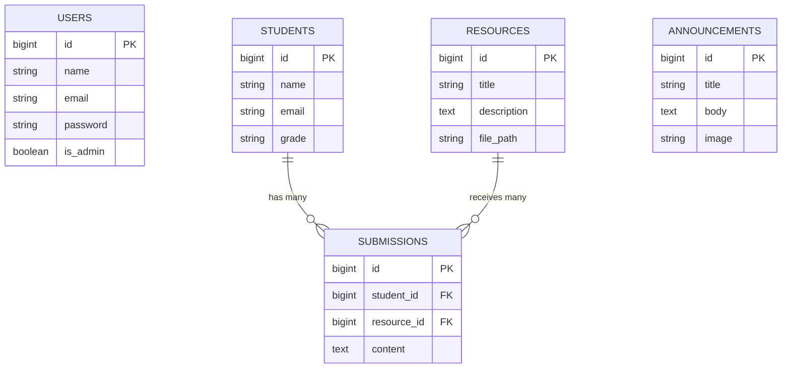

# Unit 21 — Laravel: Course Review & Capstone Project Guide
### Web Development & Programming · Grade 3 · IT Department · WE Applied Technology Schools · 2025–2026

> **Capstone:** 🏫 **School Resource & Announcement Hub**
> Routing · MVC · Eloquent & Migrations · REST API & Postman · Blade Layouts · Validation · File Uploads · Authentication · Middleware · Gates

---

## 📑 Table of Contents
1. [Source-Fidelity Note](#-source-fidelity-note-read-first)
2. [Course Overview & Core Competencies](#1--course-overview--core-competencies)
3. [The Capstone at a Glance](#2--the-capstone-at-a-glance)
4. [Environment & Prerequisites](#3--environment--prerequisites)
5. [Step-by-Step Implementation Map (10 Days)](#4--step-by-step-implementation-map-10-days)
6. [Top 10 Troubleshooting Tips & Common Errors](#5--top-10-troubleshooting-tips--common-errors)
7. [Master Review Quiz & Exam Preparation](#6--master-review-quiz--exam-preparation)
8. [Project Deliverables & Grading Rubric](#7--project-deliverables--grading-rubric)
9. [Command Cheat Sheet](#8--command-cheat-sheet)

---

## ⚠️ Source-Fidelity Note (read first)

This README is built on the **Unit 21 Laravel Student's Guide (2025–2026)**. Page numbers like *(p. 21)* point to that book. Because the book is mostly conceptual after Lesson 2, here is what is and isn't in it:

| Topic | In the book? | How it is marked in this README |
|---|---|---|
| Installation, `laravel new`, `php artisan serve`, folder structure, Artisan basics | ✅ Yes (Lesson 1) | Used as written |
| Routes, route parameters, optional parameters, route groups, controllers, Blade, `{{ }}`, passing data, middleware, `auth` | ✅ Yes, with code (Lesson 2) | Used as written |
| Eloquent, migrations, models, factories, seeders, relationships (One-to-One / One-to-Many / Many-to-Many), Query Builder, API routing in `routes/api.php`, HTTP verbs, JSON, status codes 200/404/500, API Resources | ✅ Concepts only (Lesson 3), **no code** | Concepts from the book; code is 🔧 |
| CRUD, validation, flash messages, image upload (folder + name in database), Blade layouts (`@extends`, `@yield`, `@section`/`@show`, `@parent`), CSRF token idea | ✅ Concepts + layout code (Lesson 4) | Layout code from the book; the rest is 🔧 |
| Laravel UI + Bootstrap, Breeze + Tailwind, admin dashboard 4-step outline, authentication vs authorization, Policies / Gates / custom middleware | ✅ Commands + concepts (Lesson 5) | Commands from the book; implementation is 🔧 |
| `Storage::disk('public')`, `storage:link`, `@csrf`, `@method`, `enctype`, `IsAdmin` code, `bootstrap/app.php` alias, `Gate::define` / `Gate::allows` / `abort_unless`, `$fillable`, factory/seeder code, `StudentResource` code, Postman steps, "Common Errors" tables | ❌ **Not in the book** | Tagged 🔧 |

> 🔧 **= mentor-added scaffolding.** It implements the book's concepts but is not printed in the guide. Compare it with your teacher's official workshop files.
> ⚠️ **Image storage:** the book says uploaded files are stored in a folder (**usually `public/uploads`**) with the file name saved in the database (p. 50). This capstone uses `Storage::disk('public')` as requested, which requires `php artisan storage:link` (🔧). The `public/uploads` approach from the book is offered as a bonus comparison.

---

# 1. 🎯 Course Overview & Core Competencies

## The five lessons at a glance

| Lesson | Book title | What it actually teaches |
|---|---|---|
| **1** | Introduction to Laravel and Installation | What Laravel is, why use it, MVC, tools to install (PHP, Node, Composer, Laravel Installer, editor), creating a project, folder structure, Artisan basics |
| **2** | Using Composer and Artisan | *(Content)* Routing, controllers, Blade, passing data, route parameters, grouping routes, middleware basics |
| **3** | Routing, REST and Views | *(Content)* Eloquent ORM, migrations/models/factories/seeders/relationships/Query Builder, API routing, controllers, request handling, JSON responses, API Resources |
| **4** | Blade Templates, Controllers and Migrations | CRUD, form validation, flash messages, image upload, Blade layouts, template inheritance, CSRF protection |
| **5** | Eloquent and Practical Exercises | Laravel UI + Bootstrap auth, Breeze + Tailwind auth, secure admin dashboard, authorization (Policies, Gates, custom middleware) |

> 📝 Titles and content don't always match in the book (e.g., Lesson 2's content is routing and Blade). This README follows the **content**.

## Official skill codes
| Code | Description |
|---|---|
| **TPK22** | Analyze and solve common web application tasks by writing PHP programs |
| **TPC5.7** | Using controllers and routes for APIs and URLs |
| **TPC5.8** | Creating and using Composer packages |
| **TPC5.9** | Create RESTful services and handle errors in data requests |

## Core competencies — your "I can…" checklist

| Area | After this unit, I can… | Lesson |
|---|---|---|
| **Foundations** | Explain what Laravel is and why it is the top-ranked MVC PHP framework | 1 |
| **MVC** | Describe Model (logic/data), View (UI), Controller (flow) and trace a request through them | 1, 3 |
| **Setup** | Install PHP, Node, Composer and the Laravel Installer, create a project, run `php artisan serve` | 1 |
| **Artisan CLI** | Generate code and manage the app with Artisan (`list`, `make:controller`, `route:list`) | 1, 2 |
| **Routing** | Define routes in `routes/web.php`, use parameters, optional parameters and groups | 2 |
| **Controllers** | Move logic out of routes into controller methods | 2, 3 |
| **Eloquent ORM** | Use models (table) and instances (row) instead of raw SQL | 3 |
| **Migrations** | Version-control the database structure; roll back and re-run | 3, 4 |
| **Seeders & Factories** | Fill the database with fake or initial data | 3 |
| **Relationships** | Connect tables (one-to-many, etc.) | 3 |
| **RESTful APIs** | Use `routes/api.php`, the right HTTP verbs, JSON, status codes 200/404/500 and API Resources | 3 |
| **Testing APIs** | Test endpoints with Postman and various HTTP methods | 5 (objectives) |
| **Blade** | Build dynamic views with `{{ }}`, `@if`, `@foreach` | 2, 4 |
| **Layouts** | Use `@extends`, `@yield`, `@section`/`@show`, `@parent` for template inheritance (DRY) | 4 |
| **Forms** | Validate input; show flash messages; protect with CSRF tokens | 4 |
| **File uploads** | Validate, store, and link images to records | 4 |
| **Authentication** | Scaffold login/register with Laravel UI + Bootstrap or Breeze + Tailwind | 5 |
| **Middleware** | Filter requests; use `auth`; write custom middleware | 2, 5 |
| **Authorization** | Distinguish Policies, Gates and custom middleware; protect an admin dashboard | 5 |
| **Security mindset** | Explain XSS (Blade escaping), CSRF (tokens), unauthorized access (middleware/Gates) | 4, 5 |

---

# 2. 🏫 The Capstone at a Glance

## Project: **School Resource & Announcement Hub**

A portal where the **public** can read school announcements and download learning resources, **admins** manage content through a protected panel, and a **REST API** exposes student data for other apps.

### Feature map by phase

| Phase | Theme | What you build |
|---|---|---|
| **1** | Setup & MVC | Project, Artisan, custom routes, first controllers, Blade page with data |
| **2** | Database & Eloquent | Migrations (`students`, `announcements`, `resources`, `submissions`), models with `$fillable`, factories, seeders, One-to-Many relationships |
| **3** | RESTful API | `routes/api.php`, `StudentResource`, full CRUD, Postman tests |
| **4** | Frontend & Media | Master layout inheritance, flash messages, `@csrf`, validation, upload/delete attachments with `Storage::disk('public')` |
| **5** | Auth & Access Control | Breeze auth, `is_admin` flag, `IsAdmin` middleware, Gates in `AppServiceProvider` |

### Data model (🔧 designed for this capstone)



> `users` are people who **log in** (admins and a normal user). `students` are **records** managed by the API and the admin side. Keeping them separate keeps the project simple.

### Concept coverage matrix — every workshop concept in one project

| Book concept | Where it appears in the capstone | Phase |
|---|---|---|
| MVC architecture | Every feature: Route → Controller → Model → View | 1 |
| Composer / Artisan | Project creation, `make:*`, `migrate`, `route:list` | 1 |
| Routes, parameters, groups | `/announcements/{id}`, `/admin` group | 1, 5 |
| Controllers | `HubController`, `StudentApiController`, admin controllers | 1–5 |
| Blade `{{ }}`, `@if`, `@foreach` | All views | 1, 4 |
| Migrations | 4 tables + `is_admin` | 2, 5 |
| Models & `$fillable` | All models | 2 |
| Factories & Seeders | Fake students, resources, announcements; test users | 2 |
| Relationships | Student → many Submissions | 2 |
| API routes & JSON & status codes | `/api/students` | 3 |
| API Resource | `StudentResource` | 3 |
| Postman | Test plan for 5 endpoints | 3 |
| Template inheritance | `layouts/hub.blade.php` + children | 4 |
| Flash messages | After create/update/delete | 4 |
| Form validation | Announcements, resources, students | 3, 4 |
| CSRF | `@csrf` in all forms | 4 |
| File upload & delete | Announcement image, resource file | 4 |
| Authentication | Breeze + Tailwind | 5 |
| Custom middleware | `IsAdmin` | 5 |
| Gates | `access-admin` / `manage-content` | 5 |
| Authentication vs. authorization | Login (who?) vs. admin only (allowed?) | 5 |

---

# 3. 🧰 Environment & Prerequisites

From the book (Lesson 1, pp. 11–12), you need:

| # | Tool | Purpose |
|---|---|---|
| 1 | **PHP** | The language Laravel is built on (download from php.net, or use XAMPP/Laragon on Windows) |
| 2 | **Node** (with npm) | Manages front-end dependencies |
| 3 | **Composer** | Manages Laravel and its packages (getcomposer.org) |
| 4 | **Laravel Installer** | Creates Laravel projects easily |
| 5 | **Code Editor** | e.g., Visual Studio Code |

```bash
composer global require laravel/installer
```

> 🔧 **PATH tip:** if `laravel`, `composer`, `php` or `npm` is "not recognized," the tool is not on your system **PATH**. Reinstall it (tick "add to PATH"), or add Composer's global `vendor/bin` folder to PATH, then reopen the terminal.

Also useful: a database (the Laravel default works for learning; 🔧 MySQL via XAMPP/Laragon is also fine), **Postman** for API testing, and **Git** (🔧 recommended: commit at the end of every day).

---

# 4. 🗺️ Step-by-Step Implementation Map (10 Days)

> **Rules of the road**
> 1. Finish each day's **Checkpoint** before moving on.
> 2. 🔧 Commit to Git every day: `git add . && git commit -m "Day N: ..."`.
> 3. Keep **two terminals** open when working with the front end: one for `php artisan serve`, one for `npm run dev`.
> 4. Items tagged 🔧 are mentor-added (see the fidelity note).

---

## 📅 Day 1 — Phase 1: Project Setup & First Routes

**Goal:** a running Laravel project with Breeze foundations, and your first custom routes.

### 1.1 Create the project (book, Lesson 5 p. 61 and Lesson 1 p. 11)
```bash
composer create-project laravel/laravel school-hub
cd school-hub
```
*(The book also shows `laravel new myFirstApp` as the Laravel Installer way.)*

### 1.2 Install Breeze now (🔧 order decision)
The book installs Breeze in Lesson 5, but Breeze **replaces `routes/web.php` and the layouts** when it installs. To avoid losing work, we install it **first** and build the roles in Phase 5.

```bash
composer require laravel/breeze --dev
php artisan breeze:install
npm install && npm run dev
php artisan migrate
```
> 🔧 When asked for a stack, choose **Blade** (the book's Tailwind + Blade description, p. 62).

Run the server (second terminal):
```bash
php artisan serve
```
Open `http://localhost:8000` — you should see the welcome page. Register a test account to confirm authentication works.

### 1.3 Explore the folders (book p. 12)
| Folder | Purpose |
|---|---|
| `app/` | Main code (models, controllers) |
| `routes/` | Your website's URLs |
| `resources/views/` | Blade templates |
| `public/` | Entry point; images, CSS, JS |
| `config/` | App settings |

### 1.4 Artisan warm-up (book p. 13)
```bash
php artisan list
php artisan route:list
```

### 1.5 Your first route and controller (book pp. 21–22)
```bash
php artisan make:controller HelloController
```
`app/Http/Controllers/HelloController.php`:
```php
<?php

namespace App\Http\Controllers;

use Illuminate\Http\Request;

class HelloController extends Controller
{
    public function greet()
    {
        return 'Hello from the controller!';
    }
}
```
`routes/web.php`:
```php
use App\Http\Controllers\HelloController;

Route::get('/greet', [HelloController::class, 'greet']);
```
Visit `http://localhost:8000/greet`.

✅ **Checkpoint:** `/greet` works · `php artisan route:list` shows it · you can explain the MVC flow *Request → Route → Controller → Response*.

---

## 📅 Day 2 — Phase 1: Routes, Parameters, Groups & Blade Data

**Goal:** a public `HubController` and a first Blade page that receives data.

### 2.1 Route parameters, optional parameters, groups (book p. 24)
```php
// Named parameter
Route::get('/users/{id}', [UserController::class, 'show']);

// Optional parameter (matches /users/1 and /users)
Route::get('/users/{id?}', [UserController::class, 'show']);

// Grouped routes
Route::group(['prefix' => 'admin'], function () {
    Route::get('/', [AdminController::class, 'index']);
    Route::get('/users', [AdminController::class, 'users']);
});
```
Practice these in a scratch route; you will use `{id}` and a group again later.

### 2.2 Create the public controller
```bash
php artisan make:controller HubController
```
```php
<?php

namespace App\Http\Controllers;

class HubController extends Controller
{
    public function home()
    {
        return view('hub.home', ['schoolName' => 'WE School of Applied Technology']);
    }
}
```

### 2.3 Show data in Blade (book pp. 23, 51)
`resources/views/hub/home.blade.php` *(temporary plain version; the layout comes on Day 7)*
```blade
<!DOCTYPE html>
<html>
<head>
  <title>School Hub</title>
</head>
<body>
  <h1>Welcome to {{ $schoolName }}!</h1>
</body>
</html>
```
Route:
```php
use App\Http\Controllers\HubController;

Route::get('/', [HubController::class, 'home'])->name('home');
```
> 🔧 `->name('home')` lets us use `route('home')` later.

✅ **Checkpoint:** the home page shows the school name from the controller · Blade file saved as **`.blade.php`** (book p. 23).

---

## 📅 Day 3 — Phase 2: Migrations, Models & Mass Assignment

**Goal:** four tables with models.

> 🔧 Everything in Phase 2 is mentor-designed from the book's concepts: Migration = version-controlled table file; Model = PHP class for a table; instance = row (pp. 33–34).

### 3.1 Create models and migrations (order matters)
`submissions` depends on `students` and `resources`, so create it **last**.
```bash
php artisan make:model Student -m
php artisan make:migration create_resources_table
php artisan make:model LearningResource
php artisan make:model Announcement -m
php artisan make:model Submission -m
```
> 🔧 The model is named `LearningResource` (to avoid confusion with API *Resources*), but its table is `resources`, which we set manually in the model.

### 3.2 Define the tables
**students**
```php
Schema::create('students', function (Blueprint $table) {
    $table->id();
    $table->string('name');
    $table->string('email')->unique();
    $table->string('grade');
    $table->timestamps();
});
```
**resources** *(in the `create_resources_table` migration)*
```php
Schema::create('resources', function (Blueprint $table) {
    $table->id();
    $table->string('title');
    $table->text('description')->nullable();
    $table->string('file_path')->nullable();   // path of the uploaded attachment
    $table->timestamps();
});
```
**announcements**
```php
Schema::create('announcements', function (Blueprint $table) {
    $table->id();
    $table->string('title');
    $table->text('body');
    $table->string('image')->nullable();       // path of the uploaded image
    $table->timestamps();
});
```
**submissions**
```php
Schema::create('submissions', function (Blueprint $table) {
    $table->id();
    $table->foreignId('student_id')->constrained()->cascadeOnDelete();
    $table->foreignId('resource_id')->constrained('resources')->cascadeOnDelete();
    $table->text('content');
    $table->timestamps();
});
```
Run:
```bash
php artisan migrate
```

### 3.3 Models with `$fillable` (mass assignment)
`app/Models/Student.php`
```php
protected $fillable = ['name', 'email', 'grade'];
```
`app/Models/LearningResource.php`
```php
protected $table = 'resources';
protected $fillable = ['title', 'description', 'file_path'];
```
`app/Models/Announcement.php`
```php
protected $fillable = ['title', 'body', 'image'];
```
`app/Models/Submission.php`
```php
protected $fillable = ['student_id', 'resource_id', 'content'];
```
> 🛡️ Without `$fillable`, Laravel throws **MassAssignmentException**: it protects you from saving fields you didn't intend.

✅ **Checkpoint:** `php artisan migrate:status` shows all migrations as run · you can explain why a migration is "version control for your database" (book p. 33).

---

## 📅 Day 4 — Phase 2: Relationships, Factories & Seeders

**Goal:** fake data and a working One-to-Many relationship.

### 4.1 Relationships (book p. 35: "Student has many Submissions")
`Student.php`
```php
public function submissions()
{
    return $this->hasMany(Submission::class);
}
```
`LearningResource.php`
```php
public function submissions()
{
    return $this->hasMany(Submission::class, 'resource_id');
}
```
`Submission.php`
```php
public function student()
{
    return $this->belongsTo(Student::class);
}

public function resource()
{
    return $this->belongsTo(LearningResource::class, 'resource_id');
}
```

### 4.2 Factories (fake data for testing — book p. 34)
```bash
php artisan make:factory StudentFactory --model=Student
php artisan make:factory SubmissionFactory --model=Submission
php artisan make:factory AnnouncementFactory --model=Announcement
php artisan make:factory LearningResourceFactory --model=LearningResource
```
Fill each `definition()`:
```php
// StudentFactory
return [
    'name'  => fake()->name(),
    'email' => fake()->unique()->safeEmail(),
    'grade' => fake()->randomElement(['Grade 10', 'Grade 11', 'Grade 12']),
];

// AnnouncementFactory
return [
    'title' => fake()->sentence(4),
    'body'  => fake()->paragraph(3),
];

// LearningResourceFactory
return [
    'title'       => fake()->words(3, true),
    'description' => fake()->paragraph(),
];

// SubmissionFactory
return [
    'student_id'  => Student::factory(),
    'resource_id' => LearningResource::inRandomOrder()->value('id') ?? LearningResource::factory(),
    'content'     => fake()->sentence(8),
];
```
(Add `use App\Models\Student;` and `use App\Models\LearningResource;` at the top of `SubmissionFactory`.)

### 4.3 Seeder (populate the database — book p. 35)
`database/seeders/DatabaseSeeder.php`
```php
public function run(): void
{
    LearningResource::factory(5)->create();
    Announcement::factory(5)->create();
    Student::factory(15)->has(Submission::factory()->count(2))->create();
}
```
Run:
```bash
php artisan migrate:fresh --seed
```
> ⚠️ `migrate:fresh` **drops all tables** first. Fine in development, never in production.

### 4.4 Test the relationship (🔧 Tinker)
```bash
php artisan tinker
>>> App\Models\Student::first()->submissions
>>> App\Models\Submission::first()->student->name
```

✅ **Checkpoint:** 15 students, each with 2 submissions · you can name the three relationship types the book lists (One-to-One, One-to-Many, Many-to-Many).

---

## 📅 Day 5 — Phase 3: API Routes, Controller & API Resource

**Goal:** a JSON API for students.

### 5.1 Prepare the API routes file (🔧)
The book says API routes live in **`routes/api.php`** (p. 36). In newer Laravel versions the file doesn't exist until:
```bash
php artisan install:api
```
Answer **yes** if it asks to run migrations. URLs automatically start with `/api`.

### 5.2 The API Resource (book pp. 39: "formats model data before sending it in response")
```bash
php artisan make:resource StudentResource
php artisan make:controller StudentApiController
```
`app/Http/Resources/StudentResource.php`
```php
public function toArray(Request $request): array
{
    return [
        'id'          => $this->id,
        'name'        => $this->name,
        'email'       => $this->email,
        'grade'       => $this->grade,
        'submissions' => $this->whenLoaded('submissions'),
    ];
}
```

### 5.3 The controller (CRUD → verbs, book p. 37)
```php
<?php

namespace App\Http\Controllers;

use App\Http\Resources\StudentResource;
use App\Models\Student;
use Illuminate\Http\Request;

class StudentApiController extends Controller
{
    // GET /api/students
    public function index()
    {
        return StudentResource::collection(Student::with('submissions')->get());
    }

    // GET /api/students/{id}
    public function show($id)
    {
        $student = Student::with('submissions')->find($id);
        if (!$student) {
            return response()->json(['message' => 'Student not found'], 404);
        }
        return new StudentResource($student);
    }

    // POST /api/students
    public function store(Request $request)
    {
        $data = $request->validate([
            'name'  => 'required|max:255',
            'email' => 'required|email|unique:students,email',
            'grade' => 'required',
        ]);
        return response()->json(new StudentResource(Student::create($data)), 201);
    }

    // PUT/PATCH /api/students/{id}
    public function update(Request $request, $id)
    {
        $student = Student::find($id);
        if (!$student) {
            return response()->json(['message' => 'Student not found'], 404);
        }
        $data = $request->validate([
            'name'  => 'sometimes|required|max:255',
            'email' => 'sometimes|required|email|unique:students,email,' . $student->id,
            'grade' => 'sometimes|required',
        ]);
        $student->update($data);
        return new StudentResource($student);
    }

    // DELETE /api/students/{id}
    public function destroy($id)
    {
        $student = Student::find($id);
        if (!$student) {
            return response()->json(['message' => 'Student not found'], 404);
        }
        $student->delete();
        return response()->json(['message' => 'Student deleted'], 200);
    }
}
```
> Status codes from the book: **200 OK, 404 Not Found, 500 Server Error**. `201` (created) is an optional 🔧 extra; return `200` if you want to stay strictly within the text.

### 5.4 Routes (`routes/api.php`)
```php
use App\Http\Controllers\StudentApiController;

Route::get('/students',         [StudentApiController::class, 'index']);
Route::get('/students/{id}',    [StudentApiController::class, 'show']);
Route::post('/students',        [StudentApiController::class, 'store']);
Route::put('/students/{id}',    [StudentApiController::class, 'update']);
Route::delete('/students/{id}', [StudentApiController::class, 'destroy']);
```
```bash
php artisan route:list
```
Open `http://localhost:8000/api/students` in the browser to see JSON.

✅ **Checkpoint:** the browser shows a JSON list of 15 students · you can walk through the book's **6-step API flow** (Client → Route → Controller → Model → Database → Response, optional Resource), p. 39.

---

## 📅 Day 6 — Phase 3: Test the API with Postman

**Goal:** prove every endpoint works.

> 🔧 The book names Postman as the tool for testing API endpoints (Lesson 5 objectives) but gives no steps. In Postman, **always add the header `Accept: application/json`** so validation errors come back as JSON.

### Postman test plan

| # | Method & URL | Body (raw JSON) | Expected |
|---|---|---|---|
| 1 | `GET /api/students` | — | **200** + list with `submissions` |
| 2 | `GET /api/students/1` | — | **200** + one student |
| 3 | `GET /api/students/9999` | — | **404** "Student not found" |
| 4 | `POST /api/students` | `{"name":"Mona Ali","email":"mona@example.com","grade":"Grade 11"}` | New student (201 or 200) |
| 5 | `POST /api/students` | `{"name":""}` | **422** validation errors |
| 6 | `POST /api/students` | same email as #4 | **422** (email must be unique) |
| 7 | `PUT /api/students/1` | `{"grade":"Grade 12"}` | **200** updated student |
| 8 | `DELETE /api/students/1` | — | **200** "Student deleted" |
| 9 | `GET /api/students/1` | — | **404** (it's gone) |

Save all requests into a Postman **Collection** named *School Hub API* and export it into your project (`docs/postman/`).

✅ **Checkpoint:** all 9 results match · you can explain which HTTP verb maps to which CRUD action (GET=Read, POST=Create, PUT/PATCH=Update, DELETE=Delete).

---

## 📅 Day 7 — Phase 4: Master Layout & Template Inheritance

**Goal:** one frame, many pages (DRY).

### 7.1 The master layout (pattern from book p. 53)
`resources/views/layouts/hub.blade.php`
```blade
<!DOCTYPE html>
<html lang="en">
<head>
  <meta charset="UTF-8">
  <meta name="viewport" content="width=device-width, initial-scale=1">
  <title>School Hub - @yield('title')</title>
  @vite(['resources/css/app.css', 'resources/js/app.js'])
</head>
<body class="bg-gray-100 text-gray-800">

  <nav class="bg-slate-800 text-white px-6 py-3 flex gap-6">
    <a href="{{ route('home') }}">Home</a>
    <a href="{{ route('resources.index') }}">Resources</a>
    @auth
      @can('access-admin')
        <a href="{{ route('admin.dashboard') }}">Admin</a>
      @endcan
      <a href="{{ route('dashboard') }}">My Account</a>
    @else
      <a href="{{ route('login') }}">Login</a>
    @endauth
  </nav>

  <div class="max-w-5xl mx-auto my-6 flex gap-6 px-4">
    @section('sidebar')
      <aside class="w-56 bg-white rounded p-4">
        <strong>School Hub</strong>
        <p class="text-sm">Announcements and resources for students.</p>
      </aside>
    @show

    <main class="flex-1 bg-white rounded p-6">
      {{-- Flash message (session message) --}}
      @if (session('success'))
        <div class="bg-green-100 text-green-800 p-3 rounded mb-4">{{ session('success') }}</div>
      @endif

      @yield('content')
    </main>
  </div>

  <footer class="text-center text-gray-500 py-6">Unit 21 · Laravel Capstone</footer>
</body>
</html>
```
Directives from the book: `@yield('title')`, `@section('sidebar')` + `@show`, `@yield('content')`.
> 🔧 `@auth`, `@can` and `route()` are not in the book. The `@can('access-admin')` link needs the Gate from Day 10 — **comment it out until then**, or it will simply be hidden.
> 🔧 The routes `resources.index`, `admin.dashboard`, `login`, `dashboard` must exist (we add them in Days 8–10; Breeze provides `login` and `dashboard`). Comment out links to routes you haven't created yet.

### 7.2 Public pages that extend the layout (book p. 53)
Extend `HubController`:
```php
use App\Models\Announcement;
use App\Models\LearningResource;

public function home()
{
    return view('hub.home', [
        'announcements' => Announcement::latest()->get(),
    ]);
}

public function showAnnouncement($id)
{
    return view('hub.announcement', ['announcement' => Announcement::findOrFail($id)]);
}

public function resources()
{
    return view('hub.resources', ['resources' => LearningResource::latest()->get()]);
}
```
Routes:
```php
Route::get('/',                     [HubController::class, 'home'])->name('home');
Route::get('/announcements/{id}',   [HubController::class, 'showAnnouncement'])->name('announcements.show');
Route::get('/resources',            [HubController::class, 'resources'])->name('resources.index');
```
`resources/views/hub/home.blade.php`
```blade
@extends('layouts.hub')
@section('title', 'Home')

@section('sidebar')
  @parent
  <p class="mt-3 text-sm">Announcements: {{ count($announcements) }}</p>
@endsection

@section('content')
  <h1 class="text-2xl font-bold mb-4">Latest Announcements</h1>

  @foreach ($announcements as $announcement)
    <div class="border-b py-4">
      <h2 class="text-xl">
        <a href="{{ route('announcements.show', $announcement->id) }}">{{ $announcement->title }}</a>
      </h2>
      @if ($announcement->image)
        image) }}" class="max-w-xs rounded my-2" alt="">
      @endif
      <p>{{ \Illuminate\Support\Str::limit($announcement->body, 140) }}</p>
    </div>
  @endforeach
@endsection
```
Build `announcement.blade.php` (title, image, full body) and `resources.blade.php` (list with a download link `asset('storage/' . $resource->file_path)`) in the same pattern. 🎓 *Student task.*

✅ **Checkpoint:** every public page extends `layouts.hub` and none repeats the navbar/footer · the sidebar shows the layout's text **plus** the child's line (`@parent`).

---

## 📅 Day 8 — Phase 4: Admin CRUD, Validation, Flash, CSRF & Uploads

**Goal:** create, update and delete announcements with images (and resources with files).

### 8.1 Link public storage (🔧 required for uploads)
```bash
php artisan storage:link
```
This makes files saved under `storage/app/public` reachable at `/storage/...`.

### 8.2 Controller
```bash
php artisan make:controller AnnouncementController --resource
```
> 🔧 `--resource` generates the 7 CRUD methods you wrote by hand in Lesson 4.

```php
<?php

namespace App\Http\Controllers;

use App\Models\Announcement;
use Illuminate\Http\Request;
use Illuminate\Support\Facades\Storage;

class AnnouncementController extends Controller
{
    public function index()
    {
        return view('admin.announcements.index', ['announcements' => Announcement::latest()->get()]);
    }

    public function create()
    {
        return view('admin.announcements.create');
    }

    public function store(Request $request)
    {
        // Form validation: correct, complete, safe (book p. 48)
        $data = $request->validate([
            'title' => 'required|max:255',
            'body'  => 'required',
            'image' => 'nullable|image|mimes:jpg,png|max:2048',   // image validation (book p. 50)
        ]);

        // Image upload: save the file, keep the path in the database
        if ($request->hasFile('image')) {
            $data['image'] = $request->file('image')->store('announcements', 'public');
        }

        Announcement::create($data);

        return redirect()->route('admin.announcements.index')
                         ->with('success', 'Announcement created successfully!');
    }

    public function edit(Announcement $announcement)
    {
        return view('admin.announcements.edit', ['announcement' => $announcement]);
    }

    public function update(Request $request, Announcement $announcement)
    {
        $data = $request->validate([
            'title' => 'required|max:255',
            'body'  => 'required',
            'image' => 'nullable|image|mimes:jpg,png|max:2048',
        ]);

        if ($request->hasFile('image')) {
            // delete the old file first
            if ($announcement->image) {
                Storage::disk('public')->delete($announcement->image);
            }
            $data['image'] = $request->file('image')->store('announcements', 'public');
        }

        $announcement->update($data);

        return redirect()->route('admin.announcements.index')
                         ->with('success', 'Announcement updated successfully!');
    }

    public function destroy(Announcement $announcement)
    {
        if ($announcement->image) {
            Storage::disk('public')->delete($announcement->image);   // remove the media file too
        }

        $announcement->delete();

        return redirect()->route('admin.announcements.index')
                         ->with('success', 'Announcement deleted successfully!');
    }
}
```

### 8.3 Routes (`routes/web.php`) — protected in Phase 5
For now, define them **without** the admin middleware so you can test:
```php
use App\Http\Controllers\AnnouncementController;

Route::prefix('admin')->name('admin.')->group(function () {
    Route::resource('announcements', AnnouncementController::class)->except(['show']);
});
```

### 8.4 The create form (CSRF, validation, upload)
`resources/views/admin/announcements/create.blade.php`
```blade
@extends('layouts.hub')
@section('title', 'New Announcement')

@section('content')
  <h1 class="text-2xl font-bold mb-4">New Announcement</h1>

  @if ($errors->any())
    <div class="bg-red-100 text-red-800 p-3 rounded mb-4">
      <ul>
        @foreach ($errors->all() as $error)
          <li>{{ $error }}</li>
        @endforeach
      </ul>
    </div>
  @endif

  <form action="{{ route('admin.announcements.store') }}" method="POST" enctype="multipart/form-data">
    @csrf

    <label>Title</label>
    <input type="text" name="title" value="{{ old('title') }}" class="border w-full p-2 mb-3">

    <label>Body</label>
    <textarea name="body" rows="6" class="border w-full p-2 mb-3">{{ old('body') }}</textarea>

    <label>Image (jpg or png, max 2MB)</label>
    <input type="file" name="image" class="block mb-4">

    <button type="submit" class="bg-slate-800 text-white px-4 py-2 rounded">Save</button>
  </form>
@endsection
```
Build **`index`** (table with Edit and Delete buttons), **`edit`** (form with `@csrf` + `@method('PUT')` and the current image shown) in the same pattern. The delete button is a small form:
```blade
<form action="{{ route('admin.announcements.destroy', $announcement->id) }}" method="POST">
  @csrf
  @method('DELETE')
  <button type="submit">Delete</button>
</form>
```
🎓 *Student task:* repeat the entire pattern for **resources** — create a `LearningResourceController`, route `Route::resource('resources', LearningResourceController::class)->except(['show'])`, views under `admin/resources/`, store files with `store('resources', 'public')` and use the validation rule:
```php
'file' => 'nullable|file|mimes:pdf,jpg,png,docx|max:5120',
```
(then map it to `file_path` when saving).

> 🧠 **Why the extra pieces?** `@csrf` = the token the book says Laravel requires in forms (p. 55) · `enctype="multipart/form-data"` = lets the browser send a file · `@method('PUT'/'DELETE')` = HTML forms can only send GET/POST, so Laravel "pretends".

✅ **Checkpoint:** create → flash message → shows on list; invalid input returns to the form with errors and keeps typed data; image appears on the home page; deleting removes the file from `storage/app/public/announcements/`.

---

## 📅 Day 9 — Phase 5: Roles, `IsAdmin` Middleware & Protected Routes

**Goal:** only admins can reach `/admin`.

> **Authentication** = *who are you?* (login). **Authorization** = *are you allowed?* (permissions). Breeze (Day 1) gave you authentication. Today you add authorization (book p. 65).

### 9.1 Add `is_admin` (book 4-step approach, step 1) 🔧
```bash
php artisan make:migration add_is_admin_to_users_table --table=users
```
```php
public function up(): void
{
    Schema::table('users', function (Blueprint $table) {
        $table->boolean('is_admin')->default(false);
    });
}

public function down(): void
{
    Schema::table('users', function (Blueprint $table) {
        $table->dropColumn('is_admin');
    });
}
```
```bash
php artisan migrate
```
In `app/Models/User.php`, add `'is_admin'` to `$fillable` and `'is_admin' => 'boolean'` to the casts.

### 9.2 Create the middleware (step 2) 🔧
```bash
php artisan make:middleware IsAdmin
```
`app/Http/Middleware/IsAdmin.php`
```php
<?php

namespace App\Http\Middleware;

use Closure;
use Illuminate\Http\Request;
use Symfony\Component\HttpFoundation\Response;

class IsAdmin
{
    public function handle(Request $request, Closure $next): Response
    {
        if (!auth()->check() || !auth()->user()->is_admin) {
            abort(403, 'Access denied. Admins only.');
        }

        return $next($request);
    }
}
```
Register the alias in `bootstrap/app.php` (Laravel 11/12):
```php
->withMiddleware(function (Middleware $middleware) {
    $middleware->alias([
        'admin' => \App\Http\Middleware\IsAdmin::class,
    ]);
})
```

### 9.3 Protect the routes (step 3)
Replace the Day 8 admin group with:
```php
use App\Http\Controllers\AdminController;

Route::middleware(['auth', 'admin'])
    ->prefix('admin')
    ->name('admin.')
    ->group(function () {
        Route::get('/', [AdminController::class, 'index'])->name('dashboard');
        Route::resource('announcements', AnnouncementController::class)->except(['show']);
        Route::resource('resources', LearningResourceController::class)->except(['show']);
    });
```
> The book's example of `->middleware('auth')` (p. 25): it works only if authentication is already set up — and it is, thanks to Breeze.

### 9.4 Build the admin dashboard view (step 4)
```bash
php artisan make:controller AdminController
```
```php
use App\Models\{Announcement, LearningResource, Student, User};

public function index()
{
    return view('admin.dashboard', [
        'students'      => Student::count(),
        'announcements' => Announcement::count(),
        'resources'     => LearningResource::count(),
        'admins'        => User::where('is_admin', true)->count(),
    ]);
}
```
`resources/views/admin/dashboard.blade.php` extends `layouts.hub` and shows the four counts plus links to *Announcements* and *Resources* management.

### 9.5 Test users
Add to `DatabaseSeeder::run()`:
```php
use App\Models\User;
use Illuminate\Support\Facades\Hash;

User::create([
    'name' => 'Admin User', 'email' => 'admin@example.com',
    'password' => Hash::make('password123'), 'is_admin' => true,
]);
User::create([
    'name' => 'Normal User', 'email' => 'user@example.com',
    'password' => Hash::make('password123'), 'is_admin' => false,
]);
```
```bash
php artisan migrate:fresh --seed
```
> ⚠️ Local testing credentials only.

✅ **Checkpoint:** logged out → `/admin` redirects to login · normal user → **403** · admin → dashboard.

---

## 📅 Day 10 — Phase 5: Gates, Final Testing & Presentation

**Goal:** fine-grained authorization with Gates, then the full test.

### 10.1 Define Gates (book p. 65: "Gates for general logic" — e.g., `is_admin` checks, p. 80) 🔧
`app/Providers/AppServiceProvider.php`
```php
use App\Models\User;
use Illuminate\Support\Facades\Gate;

public function boot(): void
{
    Gate::define('access-admin', function (User $user) {
        return $user->is_admin;
    });

    Gate::define('manage-content', function (User $user) {
        return $user->is_admin;
    });
}
```

### 10.2 Use the Gates
In controllers (second layer of defence), e.g., at the top of `AnnouncementController::destroy`:
```php
use Illuminate\Support\Facades\Gate;

abort_unless(Gate::allows('manage-content'), 403);
```
In Blade (show buttons only to those allowed):
```blade
@can('manage-content')
  <form action="{{ route('admin.announcements.destroy', $announcement->id) }}" method="POST">
    @csrf
    @method('DELETE')
    <button type="submit">Delete</button>
  </form>
@endcan
```
Now un-comment the `@can('access-admin')` nav link in `layouts/hub.blade.php`.

| Tool | Role |
|---|---|
| `Gate::define('name', fn)` | Write the rule once |
| `Gate::allows('name')` | Ask: yes or no? |
| `abort_unless(condition, 403)` | "Unless yes → stop with 403" |
| `@can('name')` | Show/hide parts of a Blade view |

> **Middleware vs. Gates:** middleware **filters a request** at the door of a route; a Gate is a **reusable authorization rule** you can check anywhere. The book lists *Policies* (model-specific), *Gates* (general) and *custom middleware* as Laravel's three authorization tools.

### 10.3 Full acceptance test

| # | Test | Expected |
|---|---|---|
| 1 | Open `/` logged out | Announcements visible; layout identical on every page |
| 2 | Open `/resources`, download a file | File downloads |
| 3 | Visit `/admin` logged out | Redirect to `/login` |
| 4 | Log in as `user@example.com`, visit `/admin` | **403 Forbidden** |
| 5 | Log in as `admin@example.com`, visit `/admin` | Dashboard with counts |
| 6 | Create an announcement with an image | Flash message; image on home page |
| 7 | Submit the form with an empty title | Returned to form with errors; typed data kept |
| 8 | Upload a `.pdf` as an announcement image | Validation error |
| 9 | Edit the announcement, replace the image | Old file removed from `storage/app/public/announcements/` |
| 10 | Delete the announcement | Flash message; file removed |
| 11 | Remove `_token` in DevTools and submit | **419 Page Expired** (CSRF works) |
| 12 | Run the 9 Postman requests | All match the expected results |
| 13 | `php artisan route:list` | Web, admin and API routes all present |
| 14 | `Student::first()->submissions` in Tinker | Returns 2 submissions |

### 10.4 Presentation (5 minutes)
Show: the architecture (Route → Controller → Model → View), the data model, the layout inheritance, the Postman collection, and the 403 for a normal user vs. admin access. Be ready to answer 3 questions from the Master Review Quiz.

✅ **Final checkpoint:** all 14 tests pass · Git history shows 10 daily commits · README of *your* repo lists setup steps and test accounts.

---

### 🌟 Bonus Challenges
1. **Policies:** add a Policy so only an author can edit their announcement (book names Policies as model-specific authorization).
2. **Both auth stacks:** build a second branch with **Laravel UI + Bootstrap** (`composer require laravel/ui`, `php artisan ui bootstrap --auth`) and compare it with Breeze, as the book's Lesson 5 activity requires.
3. **`public/uploads` approach:** swap `store(..., 'public')` for `move(public_path('uploads'), $name)` (the book's folder), then write down which approach you prefer and why.
4. **Optional route parameter:** make `/resources/{category?}` filter resources if a category is given.
5. **Query Builder:** add a search box using Query Builder (`where`, `orderBy`) instead of raw SQL.
6. **Custom 403 page:** build a friendly error view.
7. **More roles:** replace `is_admin` with a `role` column (`admin`, `teacher`, `student`) and update middleware and Gates.
8. **API protection:** protect the API write endpoints with `auth` middleware.

---

# 5. 🛠️ Top 10 Troubleshooting Tips & Common Errors

> The book has **no error tables**. Items marked 📘 follow rules stated in the book; items marked 🔧 are mentor-added practical fixes.

| # | Symptom | Likely cause | Fix |
|---|---|---|---|
| **1** | **`composer` / `php` / `laravel` / `npm` "not recognized"** (PATH issues) | Tool not installed or not on **PATH** 📘🔧 (Composer, PHP, Node are required: p. 11) | Install the tool, tick "add to PATH", reopen the terminal. For `laravel`, add Composer's global `vendor/bin` folder to PATH, or use `composer create-project laravel/laravel name` instead |
| **2** | **Database connection error** (`SQLSTATE[HY000]`, "could not find driver", "Access denied", "Unknown database") | Wrong or missing DB settings in `.env` 📘 (the `.env` file manages environment-specific settings: Lesson 2 objectives) 🔧 | Check `DB_CONNECTION`, `DB_HOST`, `DB_DATABASE`, `DB_USERNAME`, `DB_PASSWORD` in `.env`; make sure the DB server is running (XAMPP/Laragon); create the database; run `php artisan config:clear`, then `php artisan migrate` |
| **3** | **"Table doesn't exist" / "Column not found: is_admin"** | Migration not run (or created in the wrong order) 📘 (migrations create/modify tables: p. 33) | Run `php artisan migrate`; check `php artisan migrate:status`; in development `php artisan migrate:fresh --seed` rebuilds everything. Create `submissions` **after** `students` and `resources` |
| **4** | **MassAssignmentException** ("Add [title] to fillable property…") | `$fillable` missing in the model 🔧 | Add `protected $fillable = [...]` listing every field you create/update. Don't forget `is_admin` on `User` if you seed it |
| **5** | **419 Page Expired** | Form submitted without a CSRF token 📘 (Laravel requires a token in forms: p. 55) 🔧 | Add `@csrf` as the first line inside every `<form method="POST">`; for PUT/DELETE also add `@method(...)` |
| **6** | **403 Forbidden** | Authenticated but not authorized: `is_admin` is false, or Gate returned false 📘 (authorization: p. 65) 🔧 | Log in as the admin account; check `is_admin = 1` in the `users` table; confirm the Gate name is identical in `Gate::define` and `Gate::allows`/`@can`; run `php artisan optimize:clear` |
| **7** | **Image / file doesn't show (404 for `/storage/...`)** or "file not found" | `storage:link` was never run, or wrong path in `asset()` 🔧 | Run `php artisan storage:link`; display with `asset('storage/' . $model->image)`. For the book's `public/uploads` approach, the file must be in `public/uploads/` |
| **8** | **Page unstyled / "Vite manifest not found" / `npm run build` issues** | Front-end assets not compiled 📘 (`npm run dev` compiles assets: Q99) 🔧 | Run `npm install`, then `npm run dev` in a **second terminal** (leave it running) or `npm run build` for a one-time build |
| **9** | **"Target class [admin] does not exist" / "Class IsAdmin not found"** | Middleware alias not registered, wrong namespace, or file name mismatch 🔧 | Register `'admin' => \App\Http\Middleware\IsAdmin::class` in `bootstrap/app.php`; file `app/Http/Middleware/IsAdmin.php` with `namespace App\Http\Middleware;` |
| **10** | **404 / "Route not defined" / 405 / "View not found" / API route missing** | Wrong file, wrong name, wrong verb, or wrong Blade name 📘 (routes in `routes/web.php`; API routes in `routes/api.php`; Blade files in `resources/views/` ending `.blade.php`: pp. 20, 23, 36) 🔧 | `php artisan route:list` to see what exists · declare `/posts/create` **before** `/posts/{id}` · use `->name()` for named routes · forms need `@method('PUT'/'DELETE')` (HTML sends only GET/POST) · API: run `php artisan install:api` if `routes/api.php` is missing · check the view path and the `.blade.php` ending |

### Bonus quick fixes
| Symptom | Fix |
|---|---|
| Changes don't take effect | `php artisan optimize:clear` |
| Validation errors appear as a redirect in Postman | Add header `Accept: application/json` |
| `npm run dev` and `php artisan serve` fight | Use **two terminals** |
| Port 8000 already in use | `php artisan serve --port=8001` |
| `Undefined variable $x` in Blade | The controller didn't pass it: `view('page', ['x' => ...])` (book p. 23) |

---

# 6. 📝 Master Review Quiz & Exam Preparation

> Every answer below is taken from the Unit 21 book, with page references. Questions tagged 🔧 test the capstone code and go beyond the book.

## 📘 Workshop 1 — Introduction & Installation

**Q1.** What is Laravel?
> A free and open-source PHP framework that helps you build websites and web apps faster and easier *(p. 8)*.

**Q2.** What does MVC stand for, and what does each part do?
> Model, View, Controller. Model handles data and business logic; View presents data to users (UI); Controller manages application flow *(pp. 10, 14)*.

**Q3.** List the five tools you need before coding.
> PHP, Node (npm, for front-end dependencies), Composer, the Laravel Installer, and a code editor *(p. 11)*.

**Q4.** Write the four commands to create and run your first Laravel app, and the URL you open.
> `laravel new myFirstApp`, `cd myFirstApp`, `php artisan serve`; open `http://localhost:8000` *(p. 11–12)*. (Alternative: `composer create-project laravel/laravel name`, p. 61.)

**Q5.** Match each folder to its purpose: `app/`, `routes/`, `resources/views/`, `public/`, `config/`.
> `app/` main code (models, controllers); `routes/` website URLs; `resources/views/` HTML templates (Blade files); `public/` entry point (images, CSS, JS); `config/` app settings *(p. 12)*.

**Q6.** Give three Artisan commands from the book and what they do.
> `php artisan list` shows all commands; `php artisan make:controller HelloController` creates a controller; `php artisan route:list` shows all routes *(p. 13)*.

**Q7.** Name five reasons to choose Laravel.
> Any five of: built-in authorization system, MVC architecture, cache memory integration, seamless automation testing, simple URL routing setup, smooth database migration, detail-oriented documentation, built-in libraries, PHP community support *(p. 9)*.

**Q8.** What is the default Laravel development port, and which address is localhost?
> Port 8000; localhost is 127.0.0.1 *(p. 14)*.

## 📘 Workshop 2 — Routing, Controllers, Blade & Middleware

**Q9.** What is routing, and in which file are web routes defined?
> Routing is how Laravel connects a URL to a function or controller; web routes are defined in `routes/web.php` *(p. 20)*.

**Q10.** Name the four parts of `Route::get('welcome', function(){ return view('welcome'); });`.
> HTTP method (GET), route URI ('welcome', accessible at /welcome), closure function (returns the view), view file (`welcome.blade.php`) *(p. 20)*.

**Q11.** What are the three steps to use a controller?
> Create it with `php artisan make:controller HelloController`; add a method (e.g., `greet()`); connect the route with `Route::get('/greet', [HelloController::class, 'greet']);` *(pp. 21–22)*.

**Q12.** What does `{{ }}` do in Blade, and why is it safe?
> It outputs variables; Blade automatically escapes HTML (PHP's `htmlspecialchars()`), preventing XSS *(pp. 22, 51)*.

**Q13.** What does `{id?}` mean in a route?
> The route parameter is optional: `/users/{id?}` matches both `/users/1` and `/users` *(p. 24)*.

**Q14.** What does `Route::group(['prefix' => 'admin'], ...)` do?
> Groups related routes so all of them have `/admin` prepended to their URLs *(p. 24)*.

**Q15.** What is middleware, and what must be set up for the `auth` middleware to work?
> Middleware is a gatekeeper that checks or modifies requests before they reach routes or controllers. `auth` checks if the user is logged in and works only if Laravel authentication is already set up (e.g., Breeze, Jetstream) *(p. 25)*.

**Q16.** True/False: "All Laravel routes must be defined in `routes/api.php`."
> **False**: web routes go in `routes/web.php` *(Q22, p. 72)*.

**Q17.** True/False: "Middleware runs after a request is processed by a controller."
> **False**: middleware filters requests *before* they reach routes/controllers *(Q25, p. 72)*.

## 📘 Workshop 3 — Eloquent, Database & REST API

**Q18.** What does each Eloquent model and model instance represent?
> A model represents a table; an instance represents a row *(p. 32)*.

**Q19.** Name the six database concepts and define each in one line.
> Migration (version-controlled file that creates/modifies a table); Model (PHP class for a table); Factory (generates fake data); Seeder (populates tables with initial/test data); Relationship (how models are connected, e.g., one-to-many); Query Builder (fluent interface for database queries) *(p. 33)*.

**Q20.** Why are migrations important?
> They track all database changes, make teamwork easier by sharing changes, and let you roll back or re-run changes *(p. 33)*.

**Q21.** Which relationship types does Laravel support? Give a real-life example.
> One-to-One, One-to-Many, Many-to-Many; e.g., users and their posts, or students and their courses *(p. 35)*.

**Q22.** Match HTTP methods to CRUD.
> GET retrieves (Read); POST creates; PUT/PATCH updates; DELETE removes *(p. 37)*.

**Q23.** Where are API routes typically defined, and which format and status codes are typical?
> `routes/api.php`; JSON responses; status codes like 200 OK, 404 Not Found, 500 Server Error *(pp. 36, 38)*.

**Q24.** What is an API Resource and why use it?
> A class that formats model data before it is sent as a response; it controls which fields are shown and keeps API output consistent *(p. 39)*.

**Q25.** List the six steps of a Laravel API request.
> Client sends request → route matches and sends to controller → controller processes using the Model → Model interacts with the Database → controller returns a response (often JSON) → (optional) Resource formats the response *(p. 39)*.

**Q26.** Which statement is correct? "Factories create real user data in production" / "Factories create fake data for testing or seeding."
> The second *(Q44, p. 75; p. 34)*.

## 📘 Workshop 4 — Blade Layouts, Validation, Uploads & CSRF

**Q27.** Name the five core web app concepts of Lesson 4.
> CRUD, Form Validation, Flash Message, Image Upload, Blade Layout *(p. 46)*.

**Q28.** What does form validation ensure?
> The data is correct in format, complete (required fields not empty) and safe to store; on failure Laravel returns to the form with error messages *(p. 48)*.

**Q29.** What is a flash message and when does it disappear?
> A short, temporary notification shown after an action, handled with session messages; it disappears after navigating to another page *(p. 49)*.

**Q30.** Describe the four steps of an image upload and why validation matters.
> User selects an image → Laravel stores it in a folder (usually `public/uploads`) → the file name or path is saved in the database → the image appears with the record. Validation (size and format like `.jpg`/`.png`) matters for security and performance *(p. 50)*.

**Q31.** What is the difference between `@section` and `@yield`?
> `@section` defines content, while `@yield` displays it in a layout *(Q79, p. 78)*. In a layout, `@yield` is a placeholder for child content; `@section ... @show` defines a block that children can override or extend.

**Q32.** What do `@extends` and `@parent` do?
> `@extends` connects a child view to a master layout; `@parent` includes the layout's original section content before adding more *(pp. 53–54)*.

**Q33.** What principle does template inheritance support?
> DRY (Don't Repeat Yourself): reusable structure like headers and footers *(pp. 50, 52)*.

**Q34.** What is CSRF, and how does Laravel prevent it?
> Cross-Site Request Forgery: a malicious website, email, blog, message or program makes a user's browser perform an unwanted action on a trusted site while the user is authenticated. Laravel prevents it by requiring a token in forms *(pp. 54–55)*.

**Q35.** Why is CSRF protection necessary?
> To prevent unauthorized commands from being executed on behalf of a user *(Q80, p. 79)*.

**Q36.** Where are Blade files stored and what extension do they need?
> In `resources/views/`, with the `.blade.php` extension *(pp. 23, 51)*.

## 📘 Workshop 5 — Authentication, Middleware & Authorization

**Q37.** What is the difference between authentication and authorization?
> Authentication verifies identity (login); authorization checks permissions (access control) *(Q95, p. 79)*.

**Q38.** Compare Laravel UI and Breeze.
> Laravel UI provides auth views built with Bootstrap 5 (`composer require laravel/ui`, `php artisan ui bootstrap --auth`); Breeze uses minimal, modern Tailwind CSS (`composer require laravel/breeze --dev`, `php artisan breeze:install`). Both then run `npm install && npm run dev` and `php artisan migrate` *(pp. 61–62)*.

**Q39.** How do you generate Bootstrap auth views, and which command installs Laravel UI?
> `php artisan ui bootstrap --auth`; `composer require laravel/ui` *(Q96, Q101, p. 80)*.

**Q40.** Which npm command compiles front-end assets for Breeze, and where are its views?
> `npm run dev`; views are in `resources/views/auth/` *(Q97, Q99, p. 80)*.

**Q41.** What is an admin dashboard and why secure it?
> A protected area where only administrators manage content, users, orders or settings; an unprotected dashboard is a security risk *(p. 64)*.

**Q42.** What are the four steps of the book's secure-admin approach?
> Add an `is_admin` column to `users`; create middleware to check if the user is an admin; restrict dashboard access with it; build a simple dashboard view *(p. 64)*.

**Q43.** Name Laravel's three authorization tools and what each is for.
> Policies for model-based logic; Gates for general logic; custom middleware (used in this lesson's workshop) *(p. 65)*.

**Q44.** What is the purpose of Gates, and of the `auth` middleware?
> Gates define general authorization logic (e.g., `is_admin` checks); `auth` ensures only logged-in users can access a route *(Q98, Q100, p. 80)*.

**Q45.** True/False: "Admin dashboards should be accessible to all users." / "Authorization ensures users are logged in before accessing a page."
> Both **False**; the second describes authentication *(Q86–87, p. 79)*.

**Q46.** What must each project in the book's Lesson 5 activity include?
> A registration page, login and logout flow, a welcome dashboard after login, and a custom message on the home page ("Welcome to My Store") *(p. 63)*.

## 🔧 Capstone application questions (practical; beyond the book)

**Q47.** A normal user visits `/admin`. Which tools stop them, and what do they see?
> `auth` confirms they are logged in; `IsAdmin` (or a Gate) sees `is_admin` is false and aborts with **403 Forbidden**.

**Q48.** Your form submits but you get "419 Page Expired." What is missing?
> The `@csrf` token inside the form (Laravel requires a token in forms).

**Q49.** An upload is validated but no file arrives on the server. What's missing from the `<form>` tag?
> `enctype="multipart/form-data"`.

**Q50.** Uploaded images show as broken after deployment to a fresh machine. What command did you forget?
> `php artisan storage:link`.

**Q51.** `Student::create($data)` throws MassAssignmentException. What do you add?
> `protected $fillable = ['name', 'email', 'grade'];` in the `Student` model.

**Q52.** Give the Eloquent code for "a Student has many Submissions" and its inverse.
> `public function submissions() { return $this->hasMany(Submission::class); }` in `Student`; `public function student() { return $this->belongsTo(Student::class); }` in `Submission`.

**Q53.** Why do you delete the file in `destroy()` before deleting the record?
> Otherwise the media file stays orphaned on the disk, wasting space, even though the database row is gone (`Storage::disk('public')->delete($path)`).

**Q54.** Explain, in your own words, when you would choose a Gate instead of middleware.
> Middleware filters an entire route/group before the controller runs; a Gate is a reusable yes/no rule you can call anywhere (in a controller with `Gate::allows`/`abort_unless`, or in Blade with `@can`) — useful for fine-grained permissions such as showing a Delete button only to admins.

## 🧠 Exam-Preparation Tips
1. **Memorize the flows:** *Request → Route → Controller → Model → Database → Response (→ Resource)* and *Request → Middleware → Route → Controller*.
2. **Memorize the tables:** folders (p. 12), six database concepts (p. 33), HTTP verbs = CRUD (p. 37), five core concepts (p. 46).
3. **Know the traps:** model = table (not a row); GET never deletes; `@section` defines / `@yield` displays; authentication ≠ authorization; Laravel UI = Bootstrap, Breeze = Tailwind.
4. **Practice commands by hand** without notes: create project, `make:controller`, `route:list`, `serve`, `ui bootstrap --auth`, `breeze:install`, `npm run dev`, `migrate`.
5. **Re-do the book's own "Do I Know This Already?" sections** (Q1–101, answer key pp. 72–80) before the exam.

---

# 7. 🏆 Project Deliverables & Grading Rubric

> 🔧 Suggested rubric: adjust the weights to your teacher's requirements.

## Deliverables
- [ ] Source code in a Git repository with daily commits
- [ ] Working project (`php artisan serve` + `npm run dev`)
- [ ] Seeded database (admin + normal user accounts)
- [ ] Exported Postman collection
- [ ] Short `README` in your repo (setup steps, test accounts, features)
- [ ] 5-minute presentation

## Rubric (100 points)

| Criteria | Points |
|---|---|
| **MVC & routing** (clean routes, controllers hold logic, route parameters/groups) | 10 |
| **Database** (4 migrations, models, `$fillable`, factories, seeders, one-to-many) | 15 |
| **REST API** (correct verbs, JSON, status codes, `StudentResource`, Postman collection) | 15 |
| **Blade & layout** (single master layout, `@extends`/`@yield`/`@section`/`@parent`, DRY) | 15 |
| **Forms & media** (validation, flash messages, `@csrf`, upload + delete files) | 15 |
| **Auth & access control** (login, `is_admin`, `IsAdmin` middleware, Gates, 403 tested) | 20 |
| **Code quality & Git** (naming, structure, commit history) | 5 |
| **Presentation** | 5 |

---

# 8. ⚡ Command Cheat Sheet

| Task | Command | Source |
|---|---|---|
| Install Laravel Installer | `composer global require laravel/installer` | 📘 p. 11 |
| New project (installer) | `laravel new myFirstApp` | 📘 p. 11 |
| New project (Composer) | `composer create-project laravel/laravel name` | 📘 p. 61 |
| Start dev server | `php artisan serve` → `http://localhost:8000` | 📘 p. 11 |
| List Artisan commands | `php artisan list` | 📘 p. 13 |
| Create controller | `php artisan make:controller NameController` | 📘 p. 13 |
| Show routes | `php artisan route:list` | 📘 p. 13 |
| Install Laravel UI | `composer require laravel/ui` | 📘 p. 61 |
| Bootstrap auth views | `php artisan ui bootstrap --auth` | 📘 p. 61 |
| Install Breeze | `composer require laravel/breeze --dev` | 📘 p. 62 |
| Run Breeze installer | `php artisan breeze:install` | 📘 p. 62 |
| Front-end assets | `npm install && npm run dev` | 📘 pp. 61–62 |
| Run migrations | `php artisan migrate` | 📘 pp. 61–62 |
| Model + migration | `php artisan make:model Name -m` | 🔧 |
| Factory | `php artisan make:factory NameFactory --model=Name` | 🔧 |
| Seed | `php artisan db:seed` / `php artisan migrate:fresh --seed` | 🔧 |
| API resource | `php artisan make:resource NameResource` | 🔧 |
| API routes file | `php artisan install:api` | 🔧 |
| Middleware | `php artisan make:middleware IsAdmin` | 🔧 |
| Public storage link | `php artisan storage:link` | 🔧 |
| Clear caches | `php artisan optimize:clear` | 🔧 |
| Tinker (test code) | `php artisan tinker` | 🔧 |

---

> 🎓 **Final word to students:** you have gone from "What is Laravel?" to a secured, API-enabled, media-rich application. Every part you built answers one of the book's questions: *Who are you? Are you allowed? What does the user see? Where is the data stored?* If you can explain those four, you have understood Unit 21.
>
> **Good luck, and happy coding!** 🚀
